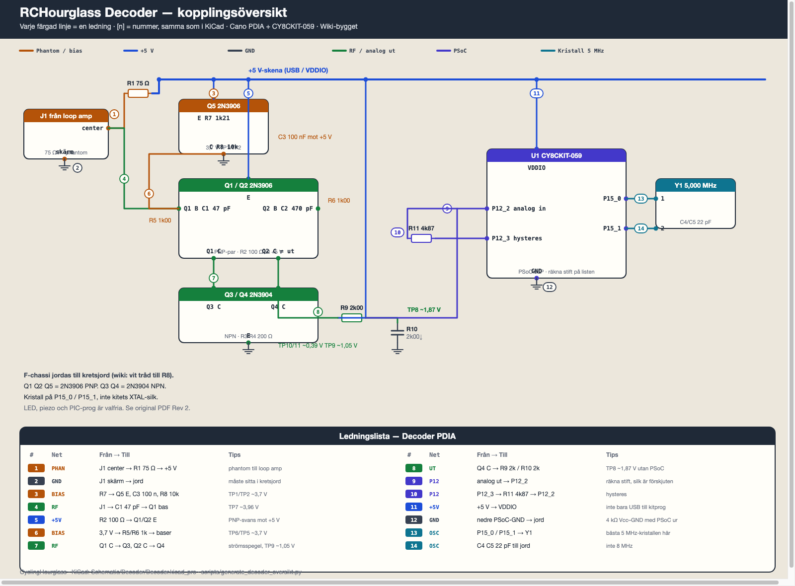
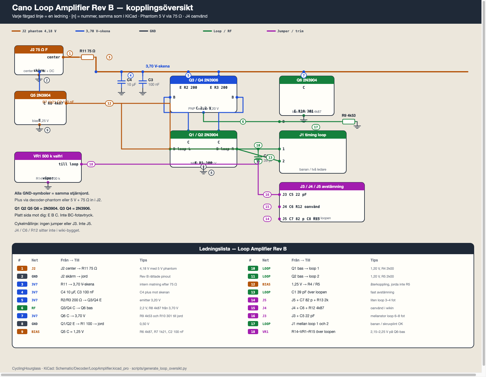

# Decoder och loop amplifier

Perfboard-bygget vi använder: **Cano loop amplifier Rev B** + **Cano PDIA** med **CY8CKIT-059**.

| | Decoder | Loop amplifier |
| --- | --- | --- |
| KiCad | [Decoder.kicad_pro](Decoder.kicad_pro) · [PDF](Decoder.pdf) | [LoopAmplifier.kicad_pro](LoopAmplifier.kicad_pro) · [PDF](LoopAmplifier.pdf) |
| Översikt | [schema_oversikt_decoder.png](schema_oversikt_decoder.png) | [schema_oversikt_loop.png](schema_oversikt_loop.png) |
| Original | [RCHourglass decoder schematic.png](original%20schematic%20files/RCHourglass%20decoder%20schematic.png) · [Decoder Schematic.pdf](original%20schematic%20files/Decoder%20Schematic.pdf) | [LoopAmplifierRevB6.jpg](original%20schematic%20files/LoopAmplifierRevB6.jpg) |

Ledningsnummer **[n]** är samma i KiCad och i översikten. Bänkchecklista: [VERIFIERING.md](VERIFIERING.md).

EasyEDA-bärarkort (inte det officiella bygget): [contrib/README.md](contrib/README.md).

# Schema

## Decoder (PDIA + PSoC)



Q1 Q2 Q5 = **2N3906** PNP. Q3 Q4 = **2N3904** NPN. Analogutgång till **P12_2**, hysteres **P12_3** via R11 4k87. Kristall **5 MHz** på **P15_0 / P15_1**. LED, piezo och PIC-prog är valfria — se original PDF Rev 2.

## Loop amplifier (Cano Rev B)



Q1 Q2 Q5 Q6 = **2N3904**. Q3 Q4 = **2N3906**. Phantom 5 V via **R11 75 Ω** in i J2. **J4 / C6 / R12** används inte i wikin. Cykelmållinje: ingen jumper eller **J3**.

Generatorer: `scripts/generate_decoder_sch.py`, `scripts/generate_loop_sch.py`, `scripts/generate_decoder_oversikt.py`, `scripts/generate_loop_oversikt.py`.

```bash
cd Schematic/Decoder
python3 scripts/generate_decoder_sch.py
python3 scripts/generate_loop_sch.py
python3 scripts/generate_decoder_oversikt.py
python3 scripts/generate_loop_oversikt.py
```
