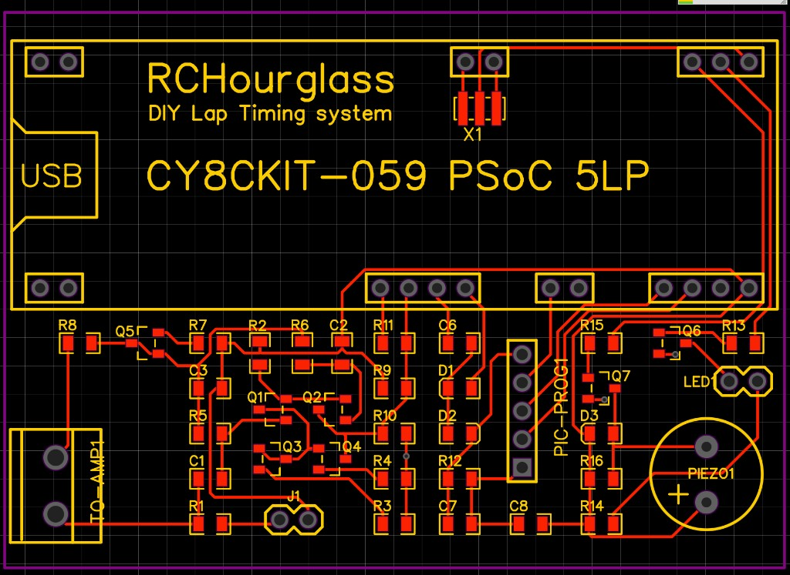
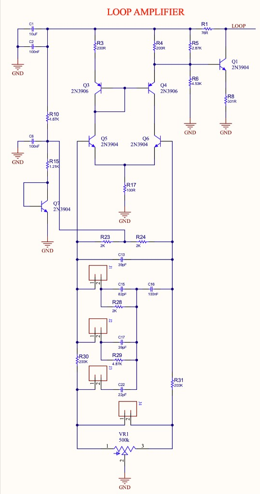

# CyclingHourglass
DIY lap timing system.

# Folder description
Community decoder boards and layouts. These are not the official perfboard build; check pinout and BOM against the schematics in the parent folder.

## EasyEDA decoder PCB (2020-11-13)

Project: [rc hourglass decoder](https://easyeda.com/modules/rc-hourglass-decoder-2020-11-13-16-59-26_d3aa110bfea84fa69c4813df5456a7bf) on EasyEDA.

Carrier board for the **CY8CKIT-059 PSoC 5LP**. The analog front end, PIC programming header, LED and piezo sit on this PCB; the PSoC kit plugs into the large outline.

Notable connectors and indicators:

| Silk | Role |
| --- | --- |
| TO-AMP1 | Input from the loop amplifier (coax / 75 Ω) |
| PIC-PROG1 | PIC programming header (transponder programming via decoder) |
| PIEZO1 | Beep on passage |
| LED1 | LED on passage |
| USB | CY8CKIT-059 USB (KitProg / PSoC) |

Loop amplifier schematic from the same EasyEDA project (component references differ from Cano Rev B):

Firmware: hex files in `Firmware/Decoder`. Open source based on work by Howard Cano and Marco Venturini; see the project license.
