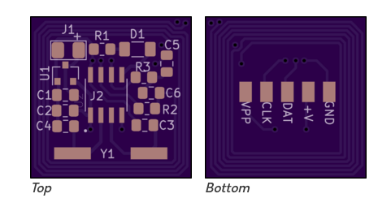
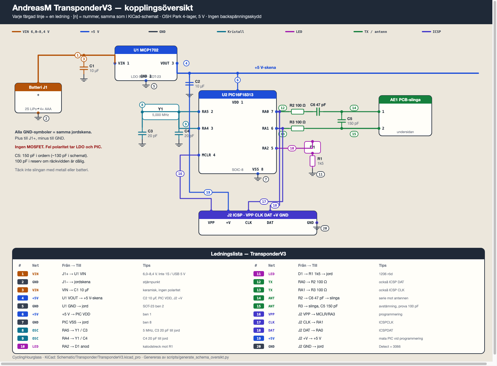

# Transponder

**Vi bygger AndreasM TransponderV3** — 4-lagerskortet på [OSH Park](https://oshpark.com/profiles/AndreasM). Det är den enda transponder vi sätter ihop i CyclingHourglass.

| | |
| --- | --- |
| Kort | 19,5 × 19,6 mm, 4 lager |
| Schema | [TransponderV3.kicad_pro](TransponderV3.kicad_pro) · [PDF](TransponderV3.pdf) · [kopplingsöversikt](schema_oversikt.png) |
| Originalschema | [original schematic files/RCHourglassTransponder.sch.svg](original%20schematic%20files/RCHourglassTransponder.sch.svg) |
| Firmware | `Firmware/Transponder/bin/RCHourglassT.X.<nummer>.hex` |
| Programmering | Undersidans dynor **VPP, CLK, DAT, +V, GND** |

Kretsen är 5 V: **U1** MCP1702 LDO, **U2** PIC16F18313 SOIC-8, **C5** antennavstämning. Antennen är kopparslingan på undersidan — linda inget extra.

# Schema

KiCad-projekt: [TransponderV3.kicad_pro](TransponderV3.kicad_pro). PDF: [TransponderV3.pdf](TransponderV3.pdf). Ledningsnummer **[1]–[20]** är samma i schemat och i översikten.

Originalschemat från RCHourglass ligger i [original schematic files](original%20schematic%20files/). Generatorerna: [scripts/generate_kicad_sch.py](scripts/generate_kicad_sch.py) och [scripts/generate_schema_oversikt.py](scripts/generate_schema_oversikt.py).

Använd inte den här listan på AndreasM **V2** (där heter avstämningen C4), WBorek (3,3 V, C5 68 pF, R1 65 Ω) eller det officiella perfboard-bygget (LP2950, MOSFET, lindad antenn). OSH Park-texten på V3 säger fortfarande “play around with **C4**” — det är V2-namn. Här stämmer du **C5**.

# Batteri och spänning

Kortet har **ingen omvändpolaritetsskydd**. Plus till **J1+**, minus till **GND**. Fel håll tar LDO och PIC.

U1 är MCP1702, **5,0 V** ut. Den behöver mer än 5 V in (dropout några tiondels volt). Absoluttak på LDO:n är 13,2 V, men C1/C2 är **10 V**-keramer — håll VIN under det.

| | Spänning | Använd? |
| --- | --- | --- |
| **2S LiPo** (rekommenderat) | 7,4 V nom., 6,4–8,4 V | **Ja.** Liten 200–500 mAh räcker en tävlingshelg |
| **4× AAA alkaline** | ca 6,0 V färsk | **Ja.** Enkelt, ingen laddare. Byt när cellerna sjunker mot 1,3 V |
| **5× NiMH AAA** | ca 6,0 V | **Ja.** Uppladdningsbart alternativ till alkaline |
| 1S LiPo / Li-ion | 3,7 V (4,2 V full) | **Nej.** LDO:n kan inte göra 5 V |
| CR2032 / knappcell | 3 V | **Nej.** Både spänning och ström för låg |
| USB-powerbank 5 V | 5,0 V | **Nej** som primär. På dropout-gränsen, PIC kan dippa |
| 3S LiPo | 11,1–12,6 V | **Nej.** LDO:n tål det, 10 V-kondingarna har ingen marginal |
| Cykel 12 V / bil USB | 12 V | **Nej** |

Praktiskt fönster: **6,0–8,4 V** in. PIC:en ska mäta ca **5,0 V** efter LDO:n.

Strömmen ligger typiskt kring **10–20 mA** (PIC + sändning + blinkande LED). En 300 mAh 2S ger i runda slängar 15–25 timmar. Sätt en liten strömbrytare i plusledningen så packen inte töms i väskan.

På cykel: tejp eller väska på ramen, **inte** metall eller LiPo-packen mitt över slingan på undersidan. Korta ledningar till **J1+** / GND. JST-PH 2-polig funkar.

# Komponenter (TME-order 35407144)

Tillräckligt för **4 kort**. Råfil: [TME-order-35407144.csv](TME-order-35407144.csv).

| Per kort | Beställt | Ref | TME / MPN | Vad | Kapsling |
| --- | --- | --- | --- | --- | --- |
| 1 | 4 | U2 | [PIC16F18313-I/SN](https://www.tme.eu/se/details/pic16f18313-i_sn/8-bit-pic-family/microchip-technology/) | PIC, 3,5 kB Flash | SOIC-8 |
| 1 | 4 | U1 | [MCP1702T-5002E/CB](https://www.tme.eu/se/details/mcp1702t-5002e_cb/) | LDO **5,0 V**, 250 mA | SOT-23 |
| 1 | 4 | Y1 | [5.00M-SMDHC49R](https://www.tme.eu/se/details/5.00m-smdhc49r/) (IQD LFXTAL012312BULK) | 5,000 MHz, 30 pF, HC-49 SMD | Crystal_SMD |
| 1 | 10 | D1 | [LTST-C150KRKT](https://www.tme.eu/se/details/ltst-c150krkt/led-smd-dioder-fargare/liteon/) | Röd LED | 1206 |
| 2 | 10 | R2, R3 | [WR08X1000FTL](https://www.tme.eu/se/details/wr08x1000ftl/) | 100 Ω 1 % | 0805 |
| 1 | 10 | R1 | [ERJP06F1501V](https://www.tme.eu/se/details/erjp06f1501v/) | 1,5 kΩ 1 % | 0805 |
| 2 | 10 | C1, C2 | [CL21A106MPFNNNE](https://www.tme.eu/se/details/cl21a106mpfnnne/) | 10 µF 10 V X5R | 0805 |
| 2 | 10 | C3, C4 | [C0805C200J5GACTU](https://www.tme.eu/se/details/c0805c200j5gactu/) | 20 pF 50 V C0G | 0805 |
| 1 | 10 | C6 | [VJ0805A470GXCAC](https://www.tme.eu/se/details/vj0805a470gxcac/) | 47 pF C0G | 0805 |
| 1 | 10 | C5 | [0805N151J500CT](https://www.tme.eu/se/details/0805n151j500ct/) | **150 pF** 50 V C0G (130 pF-ersättning) | 0805 |
| — | 10 | C5 alt. | [CL21C101JC61PNC](https://www.tme.eu/se/details/cl21c101jc61pnc/) | **100 pF** C0G, reserv för TX-avstämning | 0805 |
| 1 | — | PCB | TransponderV3, 4 lager, 19,5 × 19,6 mm | [OSH Park](https://oshpark.com/profiles/AndreasM) | |

- **C5:** schemat säger ~130 pF. Ordern har **150 pF**; **100 pF** om räckvidden är dålig. Båda C0G.
- **C1, C2:** 10 V. Okej på 5 V-sidan. 2S LiPo (8,4 V) är nära taket om kondingen sitter på VIN.
- **Y1:** 30 pF-lastkristall med 20 pF C3/C4. Tillräckligt nära. Inte hålmonterad HC-49S.
- PIC måste vara **SOIC-8** (`…/SN`), inte Electrokit DIP-8 (`…/P`).

Inte på det här kortet: summer, SMA, skruvplint, 4,87 kΩ / 1,21 kΩ, SS8050/SS8550, NE592, 1N4148.

# Bygga

SMD: 0805, 1206 LED, SOT-23, SOIC-8. Fluss och pincett. Ett unikt hex-nummer per transponder.

## Orientering

**Ovansida:** **J1+** (matningsplus), **R1 D1 C5** längs kanten, **U1** (LDO), avkoppling **C1/C2**, kristalllast **C3/C4**, sänd **R2/R3 C6**, kristall **Y1**. PIC **U2** (SOIC-8) i mitten; **J2** är tvådynan intill.

**Undersida:** antennslinga plus **VPP CLK DAT +V GND**.

## Steg 1. Kontrollera kortet

Lägg ut delarna mot silkscreen.

- **U1** är MCP1702 **5,0 V** (`…-5002E/CB`), inte 3,3 V
- **Y1** är HC-49 **SMD**, inte hålmonterad HC-49S
- **C5** är 150 pF (eller 130 pF). 100 pF-reserven åt sidan
- Inget Q1, ingen sockel, ingen 68 pF som primär C5

Inga kopparrester mellan varven på slingan.

## Steg 2. 0805-passiva

Löd motstånd och små kondingar först.

| Ref | Värde | Anmärkning |
| --- | --- | --- |
| R1 | 1,5 kΩ | LED-seriemotstånd |
| R2, R3 | 100 Ω | Push-pull till antennen |
| C3, C4 | 20 pF C0G | Kristallast |
| C5 | 150 pF C0G | Avstämning. Byt till 100 pF om räckvidden är dålig |
| C6 | 47 pF C0G | Serie mot slingan |
| C1, C2 | 10 µF X5R | Keramiska. **Ingen polaritet** |

## Steg 3. LED D1

1206 röd. Schema: PIC **RA2** → D1-anod → katod → **R1** → jord. Katodstrecket mot **R1**.

## Steg 4. U1, 5 V-LDO

MCP1702 SOT-23. Pin 1 VIN, pin 2 GND, pin 3 VOUT — matcha silkscreen.

## Steg 5. U2, PIC

`PIC16F18313-I/SN`, SOIC-8. Pin 1 (prick) är **VDD**. Felvänd PIC går sönder vid matning.

## Steg 6. Y1, 5,000 MHz

SMD HC-49, ingen polaritet. C3 och C4 ska redan sitta.

## Steg 7. Matning

Plus till **J1+**, jord till **GND** (undersidans dyna duger). Se [Batteri och spänning](#batteri-och-spänning).

## Steg 8. Programmera

Dynor: **VPP, CLK, DAT, +V, GND**. Decoder-PIC-prog (RCHourglass Manager) eller PICkit.

**Detect** ska ge modell **3066**. **Program Pic**, välj hex, behåll eller byt nummer i tweak-dialogen. Samma nummer i två transpondrar krockar i tidtagningen.

## Steg 9. Test och C5

- Efter LDO: ca **5,0 V** mot jord
- LED på RA2 blinkar när kortet sänder
- Täck inte slingan med metall
- Börja med **150 pF** på C5. Svag avläsning över loopen: prova **100 pF**

Kapsla i krympslang eller liten ask. Donera €5 per byggd transponder (projektets licens).
