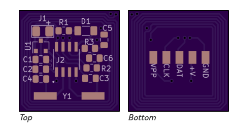

# RCHourglass
DIY lap timing system. 

# Folder description
This folder contains the modified transponder schematics, that might require modifications to the firmware and/or board layout.

## AndreasM TransponderV3 (OSH Park)

Shared 4-layer PCB: [oshpark.com/profiles/AndreasM](https://oshpark.com/profiles/AndreasM) (TransponderV3).

Same circuit as V2, but **part references match** the official RC Hourglass transponder schematic in this repo. Includes a programming terminal at the bottom and a slightly smaller footprint (0.77 × 0.77 in / 19.5 × 19.6 mm). Tune **C5** (listed as C4 on V2) for TX performance; around **130 pF** is recommended.

Firmware: [mv4wd/RCHourglass](https://github.com/mv4wd/RCHourglass) (hex files also in this repo under `Firmware/Transponder`).

Do not use the V2 BOM on this board — V2 reference designators differ from GitHub.

Shopping list with distributor links: [AndreasM/BOM.md](AndreasM/BOM.md).

| Name | Part | Package |
| --- | --- | --- |
| U1 | MCP1703 or MCP1702 LDO, 5 V output | SOT-23 |
| C1, C2 | 10 µF capacitor | 0805 |
| C3, C4 | 20 pF capacitor | 0805 |
| Y1 | Crystal 5 MHz | Crystal_SMD |
| R2, R3 | 100 Ω resistor | 0805 |
| R1 | 1.5 kΩ resistor | 0805 |
| D1 | LED | 1206 |
| C5 | 130 pF capacitor | 0805 |
| C6 | 47 pF capacitor | 0805 |
| U2 | PIC16F18313T-I | SOIC-8 |

Open source based on work by Howard Cano and Marco Venturini. Please donate €5 per built transponder to a children’s charity (see the project license).
