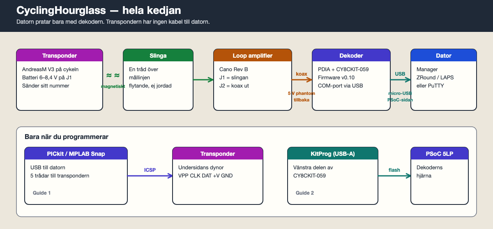
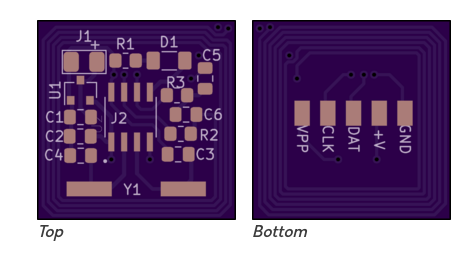
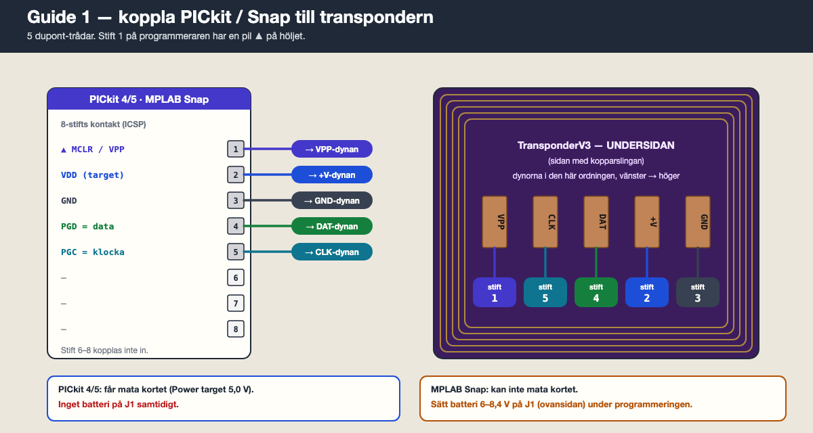

# Guide 1 — Programmera transpondern

Målet: lägga in RC Hourglass-firmware i PIC:en (**U2, PIC16F18313**) på AndreasM **TransponderV3**. Det gör du en gång per kort.

Transpondern har **ingen USB** och kopplas **aldrig** direkt till datorn. Datorn pratar med en **PIC-programmerare** (PICkit eller MPLAB Snap), och programmeraren pratar med transpondern via fem trådar.

---

## Det här behöver du

- [ ] En monterad TransponderV3 (alla komponenter lödda, se [Schematic/Transponder/README.md](../Schematic/Transponder/README.md))
- [ ] En PIC-programmerare: **MPLAB Snap** ([PG164100](https://www.microchip.com/en-us/development-tool/pg164100)), **PICkit 4** eller **PICkit 5** ([PG164150](https://www.microchip.com/en-us/development-tool/PG164150))
- [ ] USB-kabeln som följer med programmeraren
- [ ] 5 tunna trådar (dupont hona i ena änden är smidigast)
- [ ] Med **Snap**: batteri 6–8,4 V till J1 (2S LiPo, 4× AAA eller två 3 V-celler i serie). Med PICkit 4/5 behövs inget batteri.
- [ ] En dator med **MPLAB X IPE** (Windows, Mac och Linux fungerar)
- [ ] En hex-fil ur [`Firmware/Transponder/bin/`](../Firmware/Transponder/bin/)

---

## Steg 1. Känn igen kortet

| Sida | Vad du ska hitta |
| --- | --- |
| **Ovansida** (vänster bild) | **J1** uppe till vänster med **+**. Där sitter batteriet i drift. |
| **Undersida** (höger bild) | Kopparslingan runt kanten och fem dynor: **VPP · CLK · DAT · +V · GND** (vänster → höger). |

Programmeringen sker **bara** via de fem dynorna på undersidan.

---

## Steg 2. Välj transpondernummer

Varje hex-fil är ett eget nummer. Numret står i filnamnet:

`RCHourglassT.X.`**`5564690`**`.hex` → transponder **5564690**

Det finns elva färdiga nummer:

| | | | |
| --- | --- | --- | --- |
| 2351957 | 2688158 | 3073479 | 4572215 |
| 4748687 | 4961721 | 5564690 | 6000513 |
| 6091953 | 6099608 | 7531106 | |

**Ge aldrig två transpondrar samma nummer** — då går det inte att skilja cyklisterna åt. Skriv numret på kortet eller krympslangen direkt.

---

## Steg 3. Installera MPLAB X IPE

1. Gå till [MPLAB X IDE-sidan](https://www.microchip.com/en-us/tools-resources/develop/mplab-x-ide) och ladda ner installationen för ditt operativsystem.
2. Under installationen: kryssa i **MPLAB IPE**. Hela IDE:n behövs inte, men den skadar inte.
3. Kryssa i stöd för **8-bit MCUs**.
4. Starta **MPLAB IPE** (inte "MPLAB X IDE").

---

## Steg 4. Koppla de fem trådarna

Programmeraren har en 8-stifts kontakt. **Stift 1 är markerat med en pil ▲** på höljet. Använd bara stift 1–5.

| Programmerare stift | Namn | → Dyna på transpondern |
| --- | --- | --- |
| **1** ▲ | MCLR / VPP | **VPP** |
| **2** | VDD | **+V** |
| **3** | GND | **GND** |
| **4** | PGD (data) | **DAT** |
| **5** | PGC (klocka) | **CLK** |
| 6, 7, 8 | — | kopplas inte |

Observera att ordningen **inte** är samma på båda sidor. Dynorna ligger VPP–CLK–DAT–+V–GND, programmeraren 1–2–3–4–5. Följ tabellen tråd för tråd.

**Så får du kontakt med dynorna:** löd fast fem korta trådar på dynorna (de är lätta att ta bort efteråt). Att hålla trådar mot dynorna med handen ger glappkontakt mitt i programmeringen.

Dubbelkolla innan du går vidare: **+V och GND får inte vara förväxlade.**

---

## Steg 5. Ström till transpondern

PIC:en måste ha 5 V när den programmeras. Välj **ett** av alternativen:

| Programmerare | Gör så här |
| --- | --- |
| **PICkit 4 / PICkit 5** | Låt programmeraren mata kortet (Steg 6, punkt 5). **Inget batteri på J1.** |
| **MPLAB Snap** | Snap kan inte mata kortet. **Koppla batteri 6–8,4 V till J1** (+ till J1+, − till GND). |

Aldrig båda samtidigt.

---

## Steg 6. Programmera i MPLAB IPE

1. Koppla programmeraren till datorn med USB.
2. **Device:** skriv `PIC16F18313` och klicka **Apply**.
   Välj inte `PIC16LF18313` — det är en annan krets.
3. **Tool:** välj din programmerare (Snap, PICkit 4 eller PICkit 5). Står den inte där: dra ur och sätt i USB-kabeln igen.
4. Har programmeraren gammal firmware frågar IPE om uppdatering. Säg ja och vänta tills den är klar.
5. **Bara PICkit 4/5:** gå till **Settings → Advanced Mode** (standardlösenord: `microchip`). Under **Power**: kryssa i **Power target circuit from tool** och sätt spänningen till **5.0**. Gå tillbaka till **Operate**.
6. Klicka **Connect**. Loggen ska säga att **PIC16F18313** hittades.
7. **Hex File:** klicka **Browse** och välj din fil, t.ex. `RCHourglassT.X.5564690.hex`.
8. Klicka **Program**.
9. Vänta på **Programming complete**. Det tar några sekunder.

Firmware låter lågspänningsprogrammering (LVP) vara påslagen. Det betyder att även Snap kan programmera om samma krets senare.

---

## Steg 7. Koppla loss och testa

1. Klicka **Disconnect** i IPE (om du använder PICkit 4/5 slutar den mata kortet).
2. Ta bort trådarna från dynorna.
3. Koppla batteri till **J1** (+ till J1+).
4. Mät med multimeter mellan **+V** och **GND** på undersidan: ca **5,0 V**.
5. LED **D1** ska blinka — då sänder transpondern.
6. Det riktiga beviset är en passage över slingan, se [Guide 3](3-datorprogramvara.md#steg-6-första-passagen).

Upprepa från Steg 2 för nästa kort, med ett **nytt** nummer.

---

## Om det inte fungerar

| Symptom | Trolig orsak | Gör så här |
| --- | --- | --- |
| IPE hittar inte programmeraren | USB eller drivrutin | Annan USB-port/kabel. Starta om IPE. |
| "Target device not found" eller ID 0000 | Ingen ström, glapp eller fel tråd | Med Snap: sitter batteriet på J1? Mät 5 V på +V. Kontrollera VPP, DAT, CLK mot tabellen. |
| "Target VDD not detected" | Snap utan batteri, eller PICkit utan Power target | Se Steg 5. |
| Fel enhets-ID | Fel device vald, eller felvänd PIC | Device ska vara `PIC16F18313`. Pricken på PIC:en mot pricken på kortet. |
| Programmeringen avbryts halvvägs | Glappkontakt | Löd trådarna i stället för att hålla dem. |
| Programmerad men LED blinkar inte | Ingen 5 V efter LDO, eller LED felvänd | Mät 5 V på +V. Katodstrecket på LED:en mot R1. |

---

## Alternativ: programmera med dekodern

RC Hourglass-dekodern kan programmera PIC:en via **RCHourglass Manager → PIC Programming**, men bara om den valfria PIC-programmeringskretsen är byggd på dekoderkortet (se [original Decoder Schematic.pdf](../Schematic/Decoder/original%20schematic%20files/Decoder%20Schematic.pdf), Rev 2).

Vårt perfboard-bygge har **inte** den kretsen, så använd PICkit eller Snap. **Detect PIC** ska svara modell **3066** om du någon gång bygger den.

---

Nästa: [Guide 2 — Programmera dekodern](2-programmera-dekodern.md)
