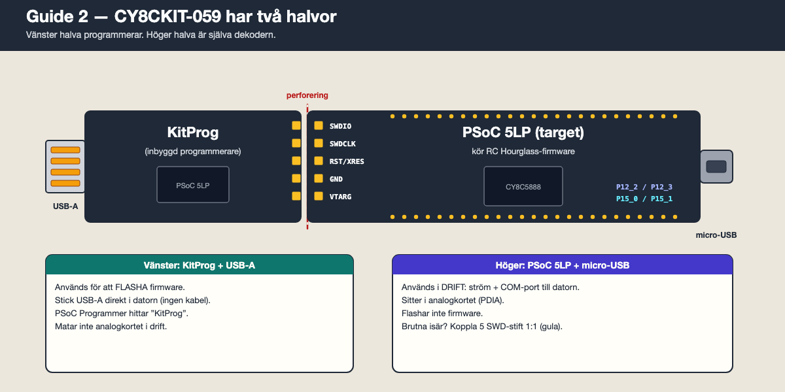

# Guide 2 — Programmera dekodern

Målet: lägga in RC Hourglass-firmware i **PSoC 5LP** på **CY8CKIT-059**, som är hjärnan i dekodern. Det här har inget med transponderns PIC att göra.

Firmware: [`Firmware/Decoder/Version010_beta.hex`](../Firmware/Decoder/Version010_beta.hex) (v0.10 beta, den senaste).

---

## Det här behöver du

- [ ] CY8CKIT-059 (gärna redan monterad på dekoderkortet)
- [ ] En **Windows**-dator. PSoC Programmer finns inte för Mac. En Windows-PC fungerar säkrast; en virtuell maskin på Mac kan gå om USB skickas vidare till den.
- [ ] En micro-USB-kabel (för drift och test efteråt)
- [ ] Hex-filen `Version010_beta.hex`

---

## Steg 1. Känn igen CY8CKIT-059



Kortet består av två delar som sitter ihop via en perforering:

| Del | Kontakt | Används till |
| --- | --- | --- |
| **KitProg** (vänster) | Stor **USB-A**-tunga | **Flasha firmware.** Sticks rakt in i datorn. |
| **PSoC 5LP** (höger) | **Micro-USB** | **Drift.** Ström + COM-port till datorn. |

Så här ser det ut på vårt bygge (KitProg till vänster, micro-USB till höger):


---

## Steg 2. Installera PSoC Programmer

1. Ladda ner från **Infineon** (Cypress köptes upp av Infineon). Använd aldrig nedladdningssidor som Softonic.
   - Fristående: [Infineon PSoC programming solutions](https://www.infineon.com/cms/en/design-support/tools/programming-testing/psoc-programming-solutions/) → **PSoC Programmer**
   - Eller hela PSoC Creator 4.4, där PSoC Programmer ingår: [direktlänk](https://softwaretools-hosting.infineon.com/packages/com.ifx.tb.tool.psoccreator/versions/4.4/artifacts/psoccreator_4.4_Windows_x86-x64.exe/download)
2. Installera med standardval. Drivrutinerna för KitProg följer med.
3. Starta **PSoC Programmer**.

---

## Steg 3. Koppla in KitProg

**Normalfallet — KitProg sitter kvar:**

1. Dra ur micro-USB-kabeln om den sitter i. Använd inte båda USB-kontakterna samtidigt.
2. Stick in **USB-A-tungan** direkt i datorn. Ingen kabel behövs (en USB-förlängare går bra).
3. Det går bra att ha PSoC kvar i dekoderkortet medan du flashar.


**Om KitProg är avbruten från PSoC-delen:**

Båda delarna har fem SWD-hål vid brytkanten: **SWDIO · SWDCLK · RST/XRES · GND · VTARG**. Löd stiftlister och koppla fem byglar **1:1** (SWDIO till SWDIO, och så vidare). Stick sedan KitProgs USB-A i datorn som ovan.

---

## Steg 4. Flasha


1. I rutan **Port Selection** till vänster: klicka på **KitProg/…**.
2. Om du får en fråga om att uppdatera KitProg-firmware: gå till fliken **Utilities** → **Upgrade Firmware**. Vänta tills den är klar och välj KitProg igen.
3. **File → File Load** (mappikonen) → välj `Version010_beta.hex`.
4. Kontrollera inställningarna på fliken **Programmer**:

   | Inställning | Värde |
   | --- | --- |
   | Programming Mode | **Reset** |
   | Verification | **On** |
   | AutoDetection | **On** |
   | Protocol | **SWD** |
   | Voltage | **5.0 V** |

5. Klicka **Program** (pilen nedåt i verktygsraden).
6. Vänta ca 20–30 sekunder. Längst ner till höger ska det stå **PASS** i grönt.
7. Dra ur KitProg ur datorn.

Dekodern är nu programmerad.

---

## Steg 5. Byt till micro-USB

1. Se till att PSoC sitter i dekoderkortet.
2. Koppla **micro-USB** på PSoC-sidan till datorn. Det är nu den kabeln som gäller i drift.
3. Datorn hittar en ny seriell port:
   - **Windows:** Enhetshanteraren → **Portar (COM och LPT)** → t.ex. **COM5**. Skriv upp numret.
     Saknas porten: installera Cypress/Infineon USB-UART-drivrutinen (följer med PSoC Creator).
   - **Mac:** i Terminal: `ls /dev/cu.usbmodem*`

Portnumret kan ändras om du byter USB-uttag. Kolla igen om något program plötsligt inte hittar dekodern.

---

## Steg 6. Testa att firmware lever

Det här testet kräver varken slinga eller loop amplifier.

**Windows (PuTTY):**

1. Ladda ner [PuTTY](https://www.putty.org/).
2. **Connection type:** Serial. **Serial line:** din port, t.ex. `COM5`. **Speed:** `115200`.
3. Under **Connection → Serial**: 8 data bits, 1 stop bit, parity None, flow control None.
4. Klicka **Open**.

**Mac (Terminal):**

```bash
screen /dev/cu.usbmodem* 115200
```

Avsluta `screen` med `Ctrl-A`, sedan `K`, sedan `Y`.

**Skriv kommandon:**

1. Skriv `VERSION` och tryck Enter. Bokstäverna syns inte medan du skriver — det är normalt.
2. Svaret ska innehålla **RC Hourglass v0.10 beta**.
3. Skriv `LICENSE` och tryck Enter. Licenstexten ska skrivas ut.

Får du svar fungerar dekodern. Stäng terminalen innan du startar något annat program mot porten.

---

## Om det inte fungerar

| Symptom | Trolig orsak | Gör så här |
| --- | --- | --- |
| Ingen KitProg i Port Selection | Fel USB-kontakt, eller drivrutin saknas | Det ska vara **USB-A-tungan**, inte micro-USB. Installera om PSoC Programmer. |
| "KitProg version expecting …" | Gammal KitProg-firmware | Utilities → Upgrade Firmware. |
| Programmeringen misslyckas | Glapp i SWD-byglarna (avbruten KitProg) | Kontrollera de fem byglarna 1:1. |
| Ingen COM-port efter flash | micro-USB inte inkopplad, laddkabel utan data | Prova en annan micro-USB-kabel. |
| Inget svar på `VERSION` | Fel port, eller porten upptagen | Rätt COM-nummer? Stäng Manager/varvprogram. Tryck Enter några gånger. |

---

## Uppdatera firmware senare

Samma steg igen med en nyare hex. Uppdateringen raderar dekoderns minne av registrerade RC4-transpondrar. Våra egna RC Hourglass-transpondrar behöver ingen registrering, så det påverkar dem inte.

---

Föregående: [Guide 1 — Programmera transpondern](1-programmera-transpondern.md) · Nästa: [Guide 3 — Datorprogramvara](3-datorprogramvara.md)
