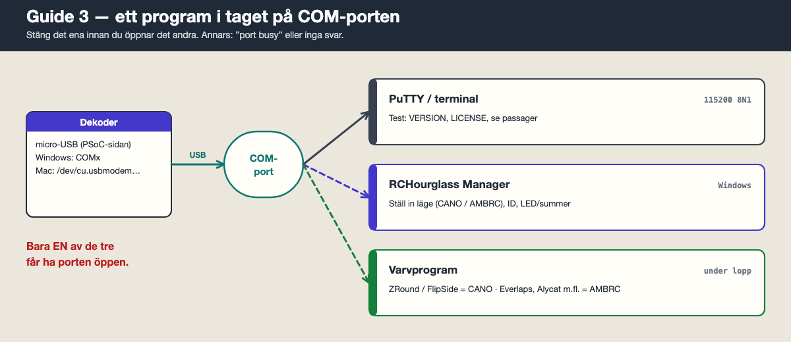
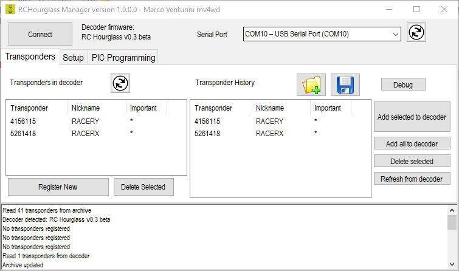
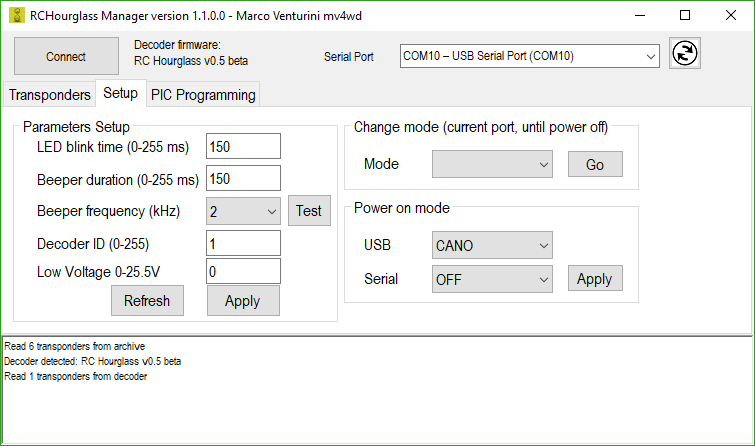
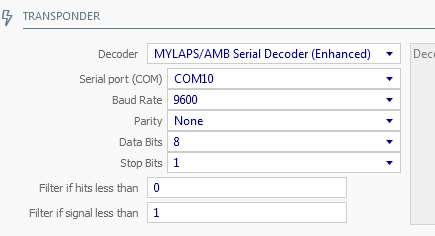

# Guide 3 — Installera och köra datorprogramvaran

Målet: få passager från dekodern in i datorn — först i ett terminalfönster, sedan i ett varvräkningsprogram.

Förutsättning: dekodern är programmerad ([Guide 2](2-programmera-dekodern.md)) och svarar på `VERSION`.

Det finns tre sorters program, och **bara ett i taget får ha COM-porten öppen**:



| Program | Används till | System |
| --- | --- | --- |
| **PuTTY / terminal** | Testa dekodern, se råa passager | Windows (PuTTY), Mac (`screen`) |
| **RCHourglass Manager** | Ställa in dekodern: protokoll, ID, LED, summer | Windows |
| **Varvprogram** | Räkna varv under lopp | Beror på program |

---

## Steg 1. Koppla in dekodern

1. **Micro-USB** från PSoC-sidan till datorn. Inte KitProg-tungan.
2. Loop amplifier kopplad till dekodern med koax. Matningen (5 V phantom) går via koaxen från dekodern — använd inte en extra matning samtidigt.
3. Slingan i loop amplifierns **J1**. Slingan ska flyta, alltså inte vara kopplad till jord.
4. Ta reda på porten:
   - **Windows:** Enhetshanteraren → **Portar (COM och LPT)** → t.ex. `COM5`
   - **Mac:** `ls /dev/cu.usbmodem*`

**Äldre varvprogram** kan bara använda COM1–COM4. Byt nummer i Windows: Enhetshanteraren → högerklicka på porten → **Egenskaper** → **Portinställningar** → **Avancerat** → välj ett lågt COM-nummer. Program som ska använda COM1–4 kan behöva **Kör som administratör**.

---

## Steg 2. RCHourglass Manager — installera

1. Ladda ner [RCHourglassManager.exe](https://github.com/mv4wd/RCHourglass/raw/master/Software/bin/RCHourglassManager.exe).
2. Ingen installation. Lägg filen i en egen mapp, t.ex. `C:\RCHourglass\`.
3. Dubbelklicka. Säger Windows "Windows skyddade datorn": **Mer information → Kör ändå**.
4. Programmet kräver .NET Framework 4, som redan finns i Windows 10 och 11.

Källkoden finns i [`Software/src/`](../Software/src/) om du vill bygga själv.

---

## Steg 3. RCHourglass Manager — anslut



1. **Stäng PuTTY och alla varvprogram.**
2. **Serial Port:** välj dekoderns COM-port.
3. Klicka **Connect**.
4. Fältet **Decoder firmware** ska visa **v0.10 beta**. Då pratar Manager med dekodern.

Fliken **Transponders** behövs inte för våra RC Hourglass-transpondrar. Registrering gäller bara MyLaps RC4.

---

## Steg 4. RCHourglass Manager — ställ in dekodern

Gå till fliken **Setup**.



### Protokoll (viktigast)

Dekodern måste prata samma språk som varvprogrammet.

| Varvprogram | Protokoll |
| --- | --- |
| ZRound, FlipSide | **CANO** |
| Everlaps, Alycat, LapsFree, RCTiming | **AMBRC** |
| Rentix | **TRANX** |
| Bara terminal / test | **CANO** eller **RCHOURGLASS** (visar även antal träffar och kvalitet) |

1. Under **Power on mode**: välj protokoll i rutan **USB**.
2. Klicka **Apply** bredvid. Inställningen sparas i dekodern och gäller efter omstart.
3. Rutan **Serial** gäller dekoderns extra hårdvaruport (stift P12_6/P12_7). Låt den vara **OFF** om du inte använder den.

**Change mode … + Go** byter protokoll bara tills dekodern stängs av. Bra för att prova.

### Övriga inställningar

1. Klicka **Refresh** för att läsa in nuvarande värden.
2. **LED blink time** och **Beeper duration / frequency**: hur LED och summer reagerar på en passage. Justera summerns frekvens tills den låter högst.
3. **Decoder ID**: låt stå kvar om du bara har en dekoder.
4. Klicka **Apply**, sedan **Test** — LED och summer ska reagera.

### Koppla ner

Klicka på anslutningsknappen igen eller stäng Manager. **Porten måste vara fri innan varvprogrammet startar.**

---

## Steg 5. Varvprogram

Välj ett. Alla behöver rätt COM-port och rätt protokoll från Steg 4.

### ZRound (Windows) — protokoll CANO

1. Installera ZRound.
2. I decoder-inställningarna: välj **CANO** och skriv in COM-porten.
3. ZRound ska upptäcka dekodern.


### Everlaps (Windows) — protokoll AMBRC

1. Välj **AmbRc** och COM-porten.
2. **Sänk minsta signalkvalitet** (minimum quality). RC Hourglass räknar kvalitet annorlunda än originalet, annars filtreras passager bort.



### LAPS (webbapp, även Mac)

[LAPS](https://github.com/snowblind/LAPS) är en Node.js-app gjord för RC Hourglass-dekodern och visar varv i webbläsaren. Följ installationsstegen i dess README. Kör den på en dator där dekodern är inkopplad.

---

## Steg 6. Första passagen

Gör det här på bänken innan du går ut på banan.

1. Lägg ut slingan platt på bordet eller golvet (inte ihoprullad).
2. Dekodern i datorn med micro-USB, loop amplifier och slinga inkopplade.
3. Öppna **PuTTY** (115200 8N1) eller `screen` på Mac. Inget annat program mot porten.
4. Sätt batteri på en programmerad transponder. LED:en ska blinka.
5. För transpondern över slingan, några centimeter ovanför tråden.
6. En rad ska dyka upp, till exempel:

   ```
   23E35500075A06
   ```

   - De första sex tecknen är transpondernumret i hex: `23E355` = **2351957**
   - De sista åtta är tiden sedan dekodern startade, i kvarts millisekunder: `00075A06` = 120,449 s

7. Stämmer numret med hex-filen du programmerade transpondern med (Guide 1) fungerar hela kedjan.

Räkna om hex till decimalt: Mac-terminal `echo $((16#23E355))`, eller Windows Kalkylatorn i läget Programmerare.

### Felsökningsläge

Skriv `MONITOR MODE` + Enter i terminalen. Dekodern skriver då ut **varje** paket den tar emot, även trasiga. Syns ingenting alls när transpondern ligger över slingan sitter felet i loop amplifier, slinga eller transponderns sändning — inte i datorn. Växla tillbaka med `CANO MODE` eller genom att starta om dekodern.

---

## Om det inte fungerar

| Symptom | Trolig orsak | Gör så här |
| --- | --- | --- |
| "Port busy" / "Access denied" | Ett annat program har porten | Stäng PuTTY, Manager och varvprogram. Öppna bara ett. |
| Manager: inget svar efter Connect | Fel port | Kontrollera COM-numret i Enhetshanteraren. |
| Varvprogrammet ser dekodern men inga varv | Fel protokoll | Ställ in samma protokoll i Manager (Steg 4) som i varvprogrammet. |
| Everlaps: passager syns i PuTTY men inte i Everlaps | Kvalitetsfilter | Sänk minsta signalkvalitet. |
| Inga rader alls i PuTTY vid passage | Analogdel, slinga eller transponder | `MONITOR MODE`. Kolla att slingan flyter, att loop amplifier har ström och att transponderns LED blinkar. |
| Fel transpondernummer | Två kort med samma hex | Programmera om ett av dem med ett annat nummer (Guide 1). |

---

Föregående: [Guide 2 — Programmera dekodern](2-programmera-dekodern.md) · Översikt: [docs/README.md](README.md)
