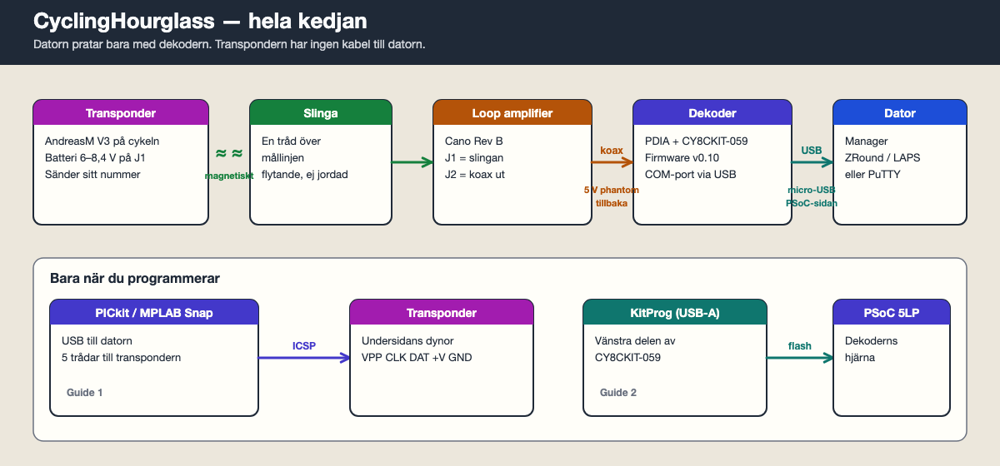

# Guider

Steg för steg från färdiglödda kort till varv på skärmen.



| Guide | Vad | Verktyg |
| --- | --- | --- |
| [1. Programmera transpondern](1-programmera-transpondern.md) | Firmware in i transponderns PIC | PICkit / MPLAB Snap + MPLAB IPE |
| [2. Programmera dekodern](2-programmera-dekodern.md) | Firmware in i CY8CKIT-059 | KitProg + PSoC Programmer (Windows) |
| [3. Datorprogramvara](3-datorprogramvara.md) | RCHourglass Manager, varvprogram, första passagen | Micro-USB + Manager / ZRound / LAPS |

Diagrammen i `bilder/` genereras med:

```bash
python3 docs/scripts/generate_guide_bilder.py
```
