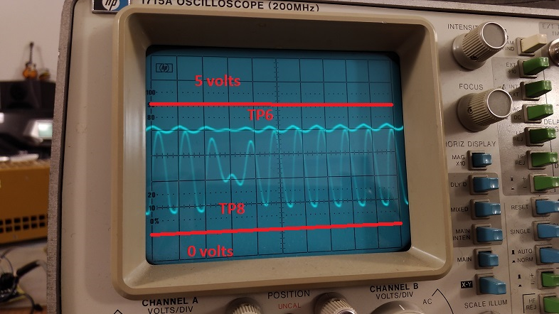
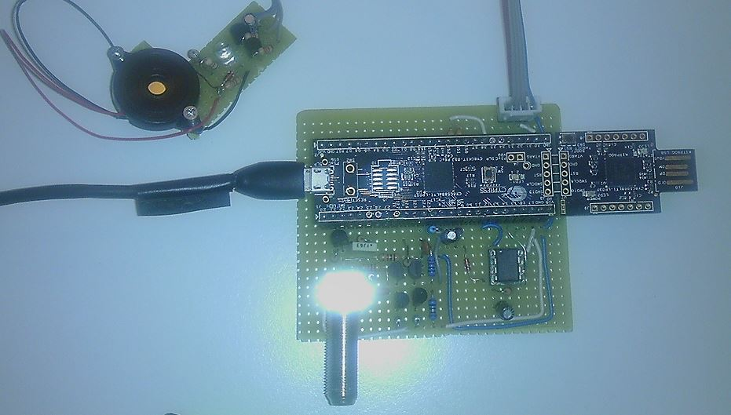

# Decoder build instructions

This instruction will guide you through building:

* the loop amplifier
* the decoder
* programming the PSOC board with the firmware

The loop amplifier is the same as **Cano** decoder, so you can use that if you already have it.

# General building tips
The project can be built on perfboard. A PCB might be useful, but I think it's better to wait the final design before investing in a PCB. One of the advantages of the PSOC module is that all the higher frequency logic is within the chip. Still the circuit amplifies the weak 5MHz transponder signal, so using a breadboard might not be a good idea.  I use to build by bending the components pins and twist/solder them, so only a couple of bridge wires are used.  

I don't say that component selection is critical, but when possible I tried to match the paired BJT's HFE and resistors values. I've used a plastic case with no shielding. Shield can be added later if necessary with aluminum foil, and probably it's most useful in the loop amplifier where the signal is lower.

For the loop connectors I've used banana style plugs, for the shielded antenna cable I've used sat TV F connectors.

**NOTE for the photos**. You might notice that BJTs on my **decoder board** photo are 'swapped'. This is because I used pairs of BC547 and BC307 instead of 2N3904 and 2N3906.

**In the build instructions I've overlayed a BJT shape to show 2N39xx orientation. The photos of the loop amplifier are for
2N3904 & 2N3906 BJTs.**

# Loop amplifier build

The loop amplifier is the original 'Cano' schematic

## Step 1.
Select the components and lay them on the schematic, to check that nothing is missing. Check markings/values twice before soldering.
Notice that J4, C6 and R12 have not been used.


[[https://github.com/mv4wd/RCHourglass/blob/master/Schematic/Decoder/LoopAmplifierRevB6.jpg|alt=The original loop amplifier schematic]]

## Step 2.

Mount the components. Beware of the connection of *R5* (see the red modification) and the connection from *C5* to *C8*.
To make the assebly fit I did join *C7* and *R13*. *R10* on my board is a series of two resistors because I didn't have 300 ohm.
The last image shows that ground lines are connect in a 'star' way, so that each component has its own ground path.











## Testing the loop amplifier

Testing can be done with a digital multimeter set on continuous voltage reading. The testpoint voltages are in Howard schematic.
You can power the loop amplifier with 5 volt source (transformer, regulator) through a **75 ohm resistor**. You can use a  voltage regulator from the transponder BOM and a battery. Add a 10 uF capacitor on the output of the regulator. Beware of the polarity.




I've tweaked the trimmer so that the measured DC voltage across the two loop inputs (without the loop connected) is zero.
If you're lucky owner of an oscilloscope, you might connect the loop and check the waveform across the **75 ohm resistor** when you have a transponder above the loop.

I suggest you don' close the loop amplifier right now.

# Building the decoder

The decoder circuit is the original Phase Detector Amplifier, powered directly with the USB Vdd from the PSOC Module (+5V).

The output of the analog amplifier feeds PSOC input **P12-2** and PSOC output **P12-3** is used for hysteresis feedback (**R11**). Two capacitors and a 5Mhz crystal provide the master clock for the circuit AND timing (across Pins 15-0 and 15-1). *The best PPM accuracy crystal should go here.*

**Note:** PSOC pin numbers refer to the **CY8CKIT-059** developer board numbering. 

## Step 1.

Select the components and lay them on the schematic, to check that nothing is missing. Check markings/values twice before soldering.

[[https://github.com/mv4wd/RCHourglass/blob/master/Schematic/Decoder/RCHourglass%20decoder%20schematic.png|alt=RCHourglass decoder schematic]]



## Step 2.

Draw a line where the PSOC connector will go and mark the pins that will be used. With so many of them it's easy to miss by one position, also some of the silkscreens labels on the PSOC board are offset from the pins. Again check twice.

Mount the input connector and resistor, together with **Q5** network. Keep lower **R8** and right **R7** pins long and unsoldered. **R8** will connect to input connector ground and to circuit ground, **R7** pin will be the +5V bus.  The other pins can be cut when soldered.

**NOTE for the photos. You might notice that BJTs on my decoder board photo are 'swapped'. This is because I used pairs of BC547 and BC307 instead of 2N3904 & 2N3906. In the build instructions I've overlayed a BJT shape to show 2Nxxxx correct orientation.**



Mount the other components of the input stage.







## Step 3.

Connect the power rails and the link to the PSOC input and **R11**. Notice the white GND wire going to the input connector chassis and **R8**

Mount the PSOC connectors. I use the pins on the PSOC board and the strip on the perfboard, but the opposite would be better (never keep exposed pins that might have voltage and shortcircuit). Double check the spacing between the two connectors. Connect the crystal and capacitors.





Lower view of the circuit



## Testing the decoder.

**Keep the PSOC daughterboard disconnected through testing!**  First thing to do would be checking the resistance between the 'to be' PSOC Vcc and GND pins. It should measure around **4KOhm**.

If you have the same 5v source used for testing the loop amplifier, connect it to the strip and power all the system (loop amplifier+decoder board). The loop amplifier should measure the same voltages as when tested alone.
You can also compare test voltages shown on the decoder schematic.

Final test setup before PSOC connection



If you have an oscilloscope, the signal from the transpoder can be checked: connect the loop with banana plugs, 2.5m length and 30 cm wide.
Put a transponder on the ground just outside the loop, about 5-8 cm from the wire, 3/4 cm from ground. Turn on the transponder and connect the scope to testpoints TP6 and TP8 in DC mode.
The signal shoul be quite clear, less than 500mVpp for TP6 signal, centerend around 4 volts. TP8 shoul be about 3Vpp centered at about 1,8V.



Test points are in the PDF schematic

[[https://github.com/mv4wd/RCHourglass/blob/master/Schematic/Decoder/Decoder%20Schematic.pdf]]


## Programming the firmware

Last thing to do is program the PSOC board. You need the software **PSOC Programmer**. This can be downloaded from Cypress website as a stand alone program, or embedded in the full **PSOC Creator Suite** (many more megabytes to download/install).
If you want to play with PSOCs, or write a new firmware, download the fulls suite. I think the paltform is worth learning because it REALLY rocks.
Once you've got PSOC Programmer running, connect the PSOC daughterboard from the large USB tab side (no cable needed). 




PSOC programmer should detect the kitprog programmer in the board and might prompt you to upgrade the programmer's firmware. I suggest you do so.

Next click the open file and browse to RCHourglass .hex file (now it's called **Version01_BETA.hex**). Click program and you should get a progress bar and a final 'green all ok' sign.



Install the **Cypress USB UART Microsoft certified driver** (again downaload from Cypress).

Connect the PSOC to the daughterboard, connect the PSOC from the other port USB (mini USB) with a cable to the PC. Your system should detect a new hardware, without asking for drivers. 

Right click on *Computer > Manage*, go to the *Device management* tree, you should find a COM port under **Ports (COM & LPT)**.

Write down the port number but keep in mind that **IT MIGHT CHANGE** when you connect to other USB ports (or after windows update).

You can now setup ZRound and test a few laps, or test the device standalone with a terminal program (like PUTTY)

To test with PUTTY, open a session to the COM port with parameters speed 115200, 8N1. Issue the **VERSION** or **LICENSE** command and you should get the response from the decoder.

**Congratulations, you've made the decoder!**

# Pic programmer and LED/Buzzer notification

## Optional circuits
The decoder can act as a PIC programmer for the chip used in the transponder. This requires fitting some optional components (see the decoder schematic)

A daugther board can be connected to provide visual (led) and acustic feedback for transponder detection.

The configuration program **RCHourglass Manager** allows to fine tune the drive frequency of the piezo for best output.


