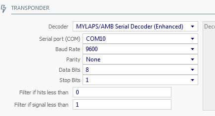
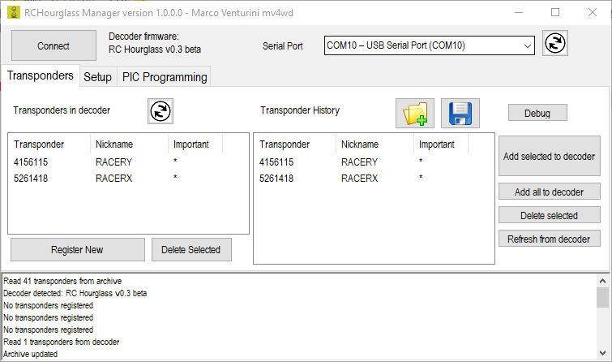
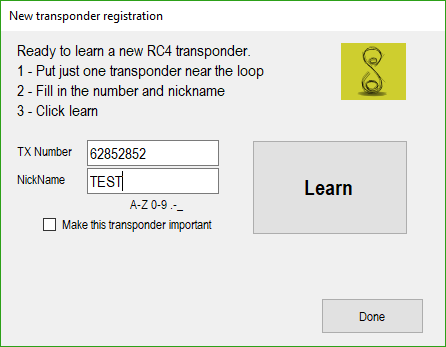
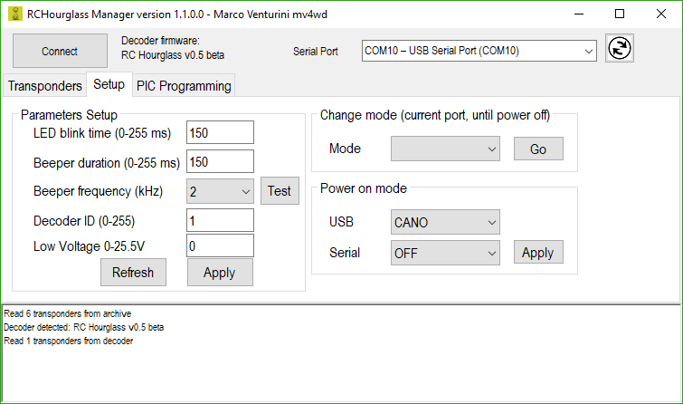
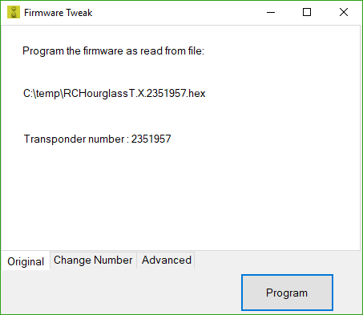
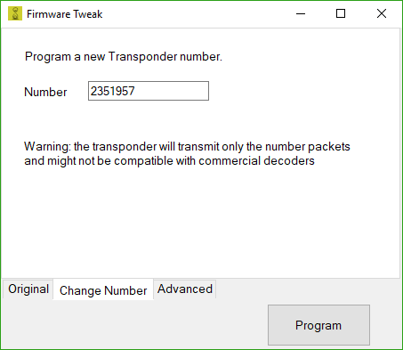
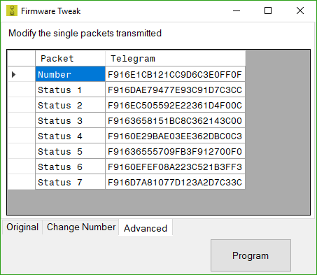

The decoder works together with a lap timing software that receives the passages times ad transponder numbers, and counts the laps, best timings etc.
RCHourglass decoder works in 'CANO' decoder emulation, this means that it's compatible with lap timing software that support the Cano protocol. Right now ZRound and Flipside racing are compatible.
The AMBRc protocol can be used with other lap timing software. Check the [[Compatibility chart|Compatibility]] for tested softwares

# Basic setup
The decoder must be connected with USB after having installed Cypress USB serial drivers for windows. Once installed, connect the USB cable to the PC and the hardware should be detected and installed. In the computer device manager a new COM port should appear. The number of that COM port (for example COM 10) must be remembered to setup the lap timing software.


# ZRound setup
The setup in ZRound requires enabling the CANO decoder and writing the correct COM port number in the setup dialog.
Once done, the software should be able to detect the decoder



# Everlaps setup
The setup in Everlaps requires enabling the AmbRc protocol in the decoder and writing the correct COM port number in the setup dialog.
It's important to lower the minimum signal quality requested for valid reads (quality calculation differs from the original).



# Use of RCHourglassManager

RCHourglassManager is a software utility to manage the RCHouglass decoder.
It can be downloaded from [here](https://github.com/mv4wd/RCHourglass/blob/master/Software/bin), and source code is available [here](https://github.com/mv4wd/RCHourglass/blob/master/Software/src)



The first operation is to connect to the decoder.
**It is VERY important that the lap timing software is shut down or disconnected from the serial port**

Select the serial port from the drop down list and click **Connect**

A licensing screen will appear and decoder firmware version will be shown.


# Transponder management

The RC4 transponders can be detected only after they've been registered in the decoder memory. RC4 Hybrid should not need registration, but a better decoding is achieved by registering the transponder.

RC3 transponders, CANO, MRT and RCHourglass **do not need** registration. 

A maximum of 40 transponders can be kept in the memory and persist even in case of power disconnection.


## How to register RC4 transponder

Place and stop the car above the wire. The blue LED on the PSOC board should be well lit.

Avoid any other car passage when registering a transponder.

Click the **Register new** button.

A screen will appear to enter the transponder number and a nickname. A check box allows to register the transponder as an important one.



The decoder will learn and return success or failure. In case of failure or bad quality read, reposition the car and/or check correct loop connection.
Try both the center of the loop as well as the transponder slightly outside the loop.  

Every learnt transponder is recorded also on the computer as a history. This allows to manage more than 40 transponders by adding and removing from the decoder memory as needed.

The transponder history can be saved or read from an XML file. 
**The transponder history is very important in case of firmware update of the decoder. ANY registration will be deleted from the decoder memory when upgraded**

## Important transponder 

When you register a transponder, there's the option to say it is important. This is because in case of full memory (40 transponders) any new transponder registered will remove the oldest learnt transponder.
Important transponders cannot be automatically deleted from the decoder memory.

The left 'Delete selected' will delete from decoder memory all the selected transponders.

# Setup Page



The setup screen allows to configure the decoder notification. LED and beep duration and frequency can be changed.
Make sure you **Apply** the beep and led changes before testing with the test button.

Also it's possible to switch the decoder startup protocol for the two serial ports, or switch the current compatibility mode.
The decoder ID is used if multiple decoders are used.
The low voltage threshold is used for AMBrc emulation, to notify a low power status if the transponder voltage is below it.


# Pic programming page

This page is available to program a PIC with the programming hardware of the decoder.

The **Detect** button detects the PIC model in the programmer socket, and checks the hardware functionality.

The **Program Pic** button is used to program one of the firmware available for the transponder.

Select one of the official RCHourglass firmware hex file, and then a 'Tweak' dialog is shown

Here one of three options can be selected

* Program the original firmware (as is).   Just click and wait for completion

* Change the number of the transponder. This will create a transponder with a custom number. Not guarateed to work with Mylaps decoders

* Change the single packets transmitted. Advanced option to write every packet transmitted by the decoder. If you use it, you don't need any instruction.





