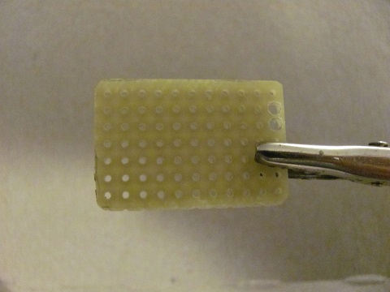
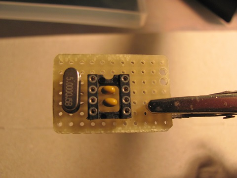
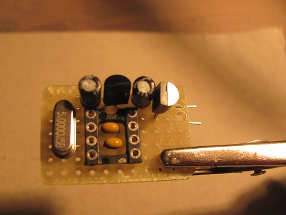
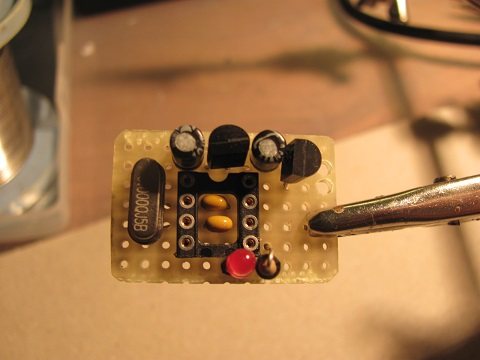
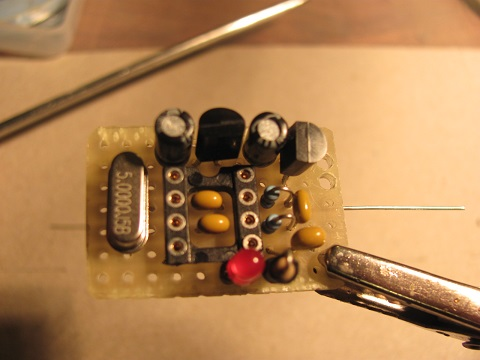
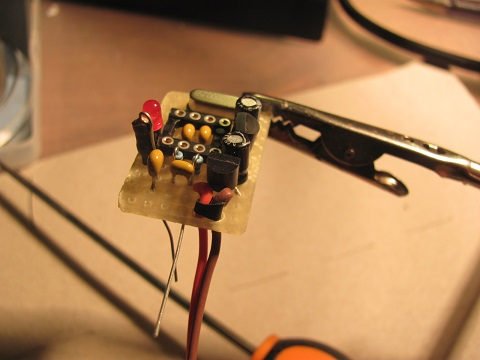
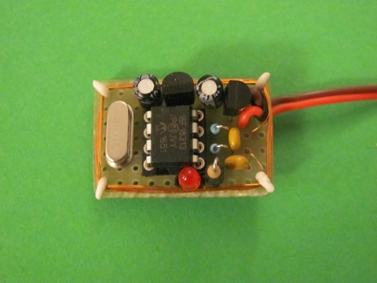
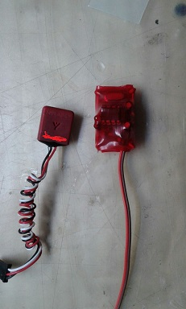

# Transponder build instructions

This instruction will guide you through building a transponder to use in the car.

The PIC chip used in the transponder can be programmed with the decoder optional programmer hardware or Microchip tools.

# Vilken variant?

**CyclingHourglass bygger AndreasM TransponderV3.** Lödsteg, BOM och batteri/spänning: [Schematic/Transponder/README.md](../Schematic/Transponder/README.md).

| Variant | Var |
| --- | --- |
| **AndreasM TransponderV3** (det vi bygger) | [Schematic/Transponder/README.md](../Schematic/Transponder/README.md) |
| Officiellt perfboard (hålmonterat) | Kapitlet nedan |
| AndreasM Transponder**V2** / WBorek | [contrib/README.md](../Schematic/Transponder/contrib/README.md) — använd inte V3-BOM:en |

# Perfboard (officiellt genom-hålsbygge)

# General building tips

The project can be built on perfboard. The critical part for manual assembly is winding the spiral antenna. The circuit itself is very simple.

## Step 1.

This is the schematic for the transponder:

[[https://github.com/mv4wd/RCHourglass/blob/master/Schematic/Transponder/RCHourglassTransponder.sch.svg|alt=RCHourglass transponder schematic]]

Cut a small piece of perfboard 7 holes *  11 holes (standard 0.1 inch). Notice in the image the two larger holes drilled for the servo wire.

Install the chip socket and solder the **5MHz** crystal and the two capacitors **C3** and **C4**. The chip is held in place by the solder on pins 2 and 3. Leave the other pin of C3 and C4 unsoldered.

Mount all the power supply components:

* the P Mosfet **Q1** VP2106N3-G
* the low drop regulator **U1** LP2950
* the two filter capacitors **C1** and **C2** - **CHECK THE POLARITY**

Leave the ground pins unconnected, and solder all the others. Pin 1 of the chip socket will be soldered as well. Leave unconnected the two input pins of **Q1** as in the image:

Mount the LED and the limiting resistor **R1**. Use a piece of shinrk tube around R1 and led pins to avoid rubbing against the antenna wire. Align one terminal of the LED to the teriminals of capacitors *C3* and *C4*. When bent, it will connect most of the ground points.

Mount the output resistors **R2** and **R3** and the two capacitors **C5** and **C6**.
Leave unsoldered the pins that go to the antenna, solder and cut all the other.

Connect the servo wire. Use a piece of shrink tube as an extra strain relief across the two enlarged holes. Bend and solder the wire, and connect all the ground points.

Solder 4 small pieces of wire in the four corners. Wrap **19 turns of 0.125 mm diameter** enamel-insulated wire around the board. Clear the ends and solder to the output terminals of *C5* and *C6*. Bend the corners on the outside. Program the PIC with the firmware and push it into the socket

You can wrap the transponder in rigid shrink plastic or in a small box. This is how it looks:

